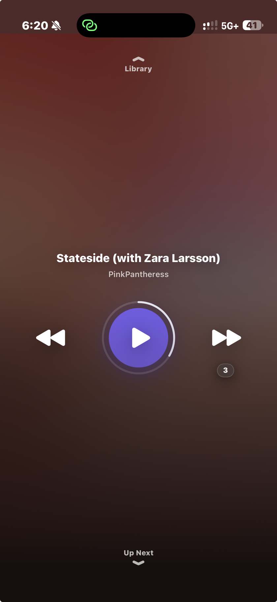
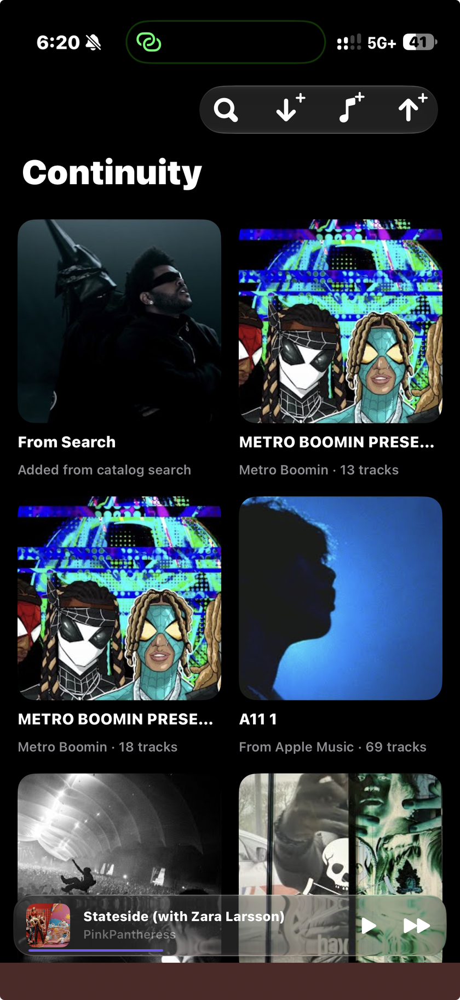
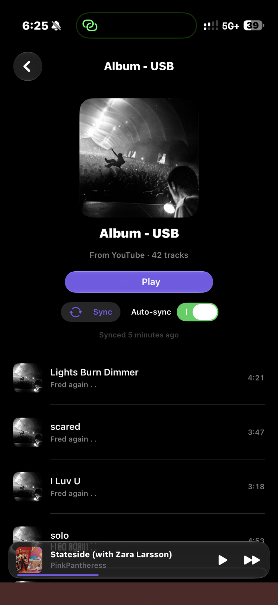
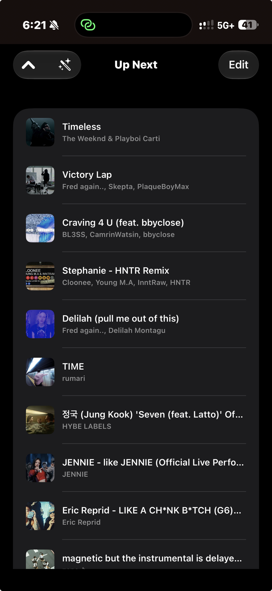

# Continuity

Anyone who merges a PR gets a free copy of the premium version of Continuity

<p align="center">
  <a href="docs/screenshots/now-playing.png"></a>
  <a href="docs/screenshots/library.png"></a>
  <a href="docs/screenshots/playlist.png"></a>
  <a href="docs/screenshots/up-next.png"></a>
</p>

A minimal native iOS music app with one differentiating feature: **transitions so smooth you
don't notice a song changed**. It is a configurable, higher-quality take on Apple Music's
Automix, with stem-separated, beatmatched, harmonically-mixed DJ blends.

A **personal portfolio prototype**: iOS 26+, SwiftUI + `AVAudioEngine`, music sourced from
YouTube (see [Caveats](#caveats)). Artists receive a minimum **80% revenue share**.

## Features

**Transition engine.** Two decks on one `AVAudioEngine`; every track change is a blend.

- **Crossfade**: 0–16 s, with linear, equal-power or smooth curves
- **Beatmatching**: tempo-matches the incoming track (±8%, half/double-time aware) and
  aligns its first beat to the outgoing one
- **Bass swap**: a low-shelf EQ fades the incoming low end in, so basslines never stack
- **Harmonic mixing**: shifts the incoming track up to ±1 semitone into a Camelot-compatible key
- **Vocal-aware blends**: on-device vocal/accompaniment stems (HT-Demucs on ONNX Runtime) let
  the outgoing vocal duck under the incoming instrumental
- **Loudness leveling**: every track is brought to −14 LUFS (BS.1770)
- **Gapless**: leading and trailing silence is trimmed from transition timing
- **Blend ratings**: thumbs up or down on a transition adapts how that pair blends next time

**Analysis.** BPM, beat grid and musical key are computed once per track, cached, and
versioned so analyzer improvements re-analyze old libraries.

**Player.** The app opens *playing*: a three-control Now Playing screen that resumes the last
session, with the library one page above and Up Next one page below. Forward skips are
budgeted radio-style (3, earned back by finishing tracks); going back is unlimited.

**Up Next.** Drag to reorder, swipe to remove, "Play Next" from anywhere. **Flow** reorders
the queue by key and tempo, like a DJ set.

**Import.** One "+" hub takes a YouTube, Spotify or SoundCloud link, a connected account's
playlists and likes (OAuth + PKCE), Apple Music, or local files. Catalog search adds single
songs and albums. Spotify, SoundCloud and Apple Music supply tracklists only; audio is matched
from YouTube. Tracks download, analyze and stem-separate in the background, and source-backed
playlists sync with their remote.

**Links in.** A `continuity://import?url=…` scheme, a share extension, and a clipboard offer
at launch. Every path asks before importing.

## Project layout

```
project.yml                     XcodeGen spec; the Xcode project is generated, not committed
App/Continuity/                 app target: SwiftUI views + wiring
App/ShareExtension/             "share → Continuity"
Packages/ContinuityCore/        pure Swift, no dependencies: transition and DSP math, BPM/key
                                analysis, flow ordering, link/page/API parsing, OAuth PKCE
Packages/ContinuityKit/Sources/
  Domain/                       SwiftData models, TransitionSettings, audio/stem caches
  Ingest/                       resolvers, accounts, downloader, analysis, stem separation, sync
  Playback/                     dual-deck engine (Player, Deck), Now Playing bridge
```

Modules depend only downward. Anything fragile (scraping) or mathematical (DSP, transition
logic) lives in `ContinuityCore`, pinned by unit tests that run without a simulator.
[`AGENTS.md`](AGENTS.md) has the full architecture and gotchas.

## Build & test

Requires Xcode 26+ and [XcodeGen](https://github.com/yonaskolb/XcodeGen).

```sh
brew install xcodegen                      # once
xcodegen generate                          # generates Continuity.xcodeproj
open Continuity.xcodeproj                  # run on an iOS 26 simulator or device

cd Packages/ContinuityCore && swift test   # core tests; also runs on Linux
```

## Caveats

- **YouTube sourcing violates YouTube's ToS**, so `main` is a private prototype and not
  App-Store-shippable. The engine is source-agnostic; the local-files variant lives on
  `appStoreReleaseCandidate`.
- **Stem separation is CPU-only** (~2–4 min per track on the simulator) and downloads a
  ~158 MB model on first use. Never enable ONNX Runtime's CoreML execution provider: session
  creation alone hits the jetsam limit.
- **Spotify playlists cap at ~50 tracks without an account.** Account sign-in needs OAuth
  client ids at build time (checklist in [`AGENTS.md`](AGENTS.md)); until then links still
  import by scraping.
- **Playlist sync is polling** (launch + manual). Push would need a server.

## Status

Milestones M0–M5 are built: ingestion, dual-deck crossfades, analysis and beatmatching,
on-device stems with vocal-aware blends, and persistence and stability polish. Device
validation of stem-separation timing and memory behaviour continues.
